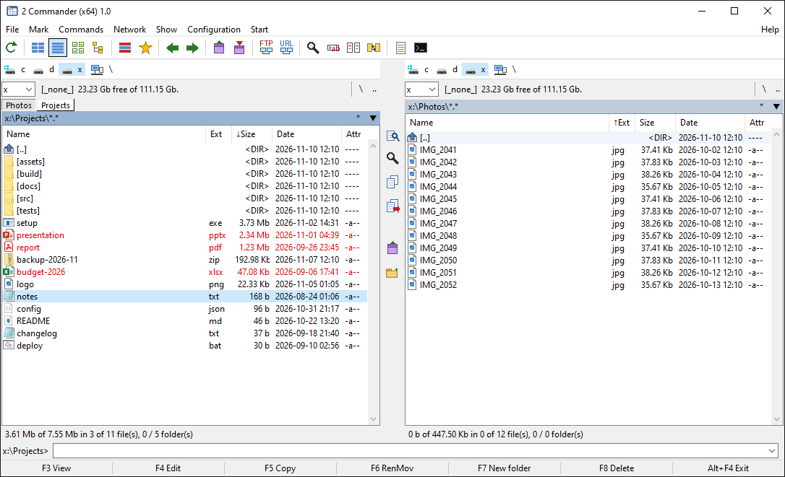
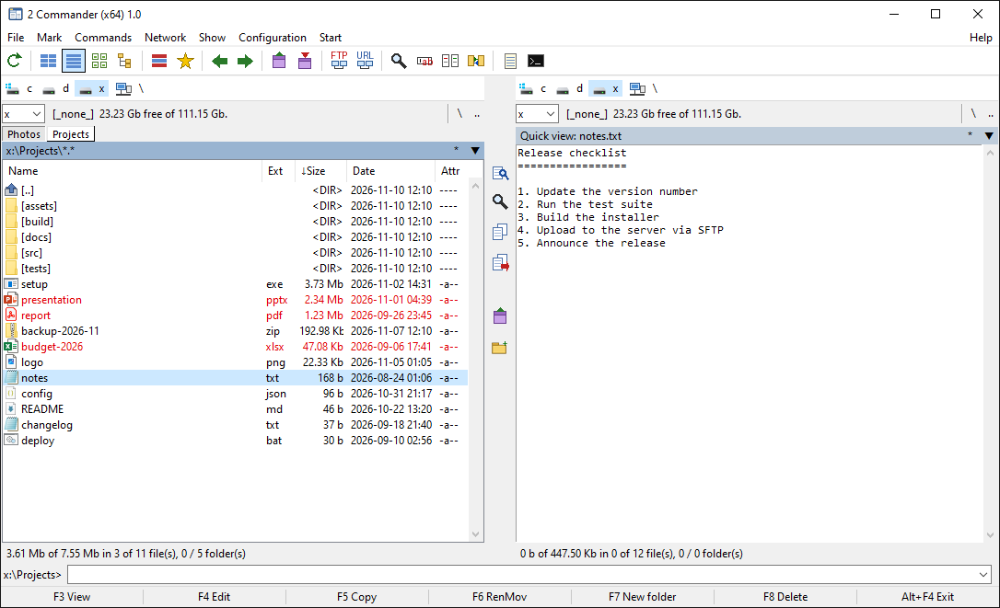
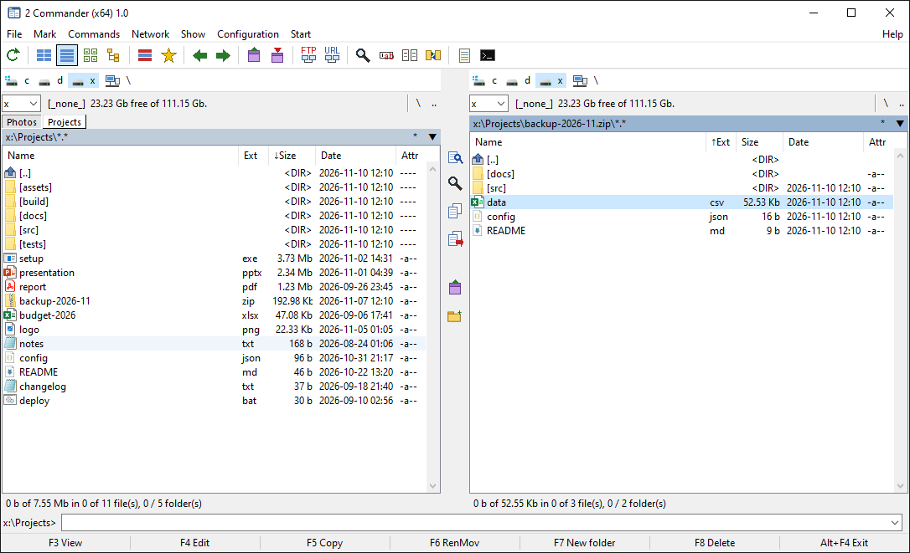
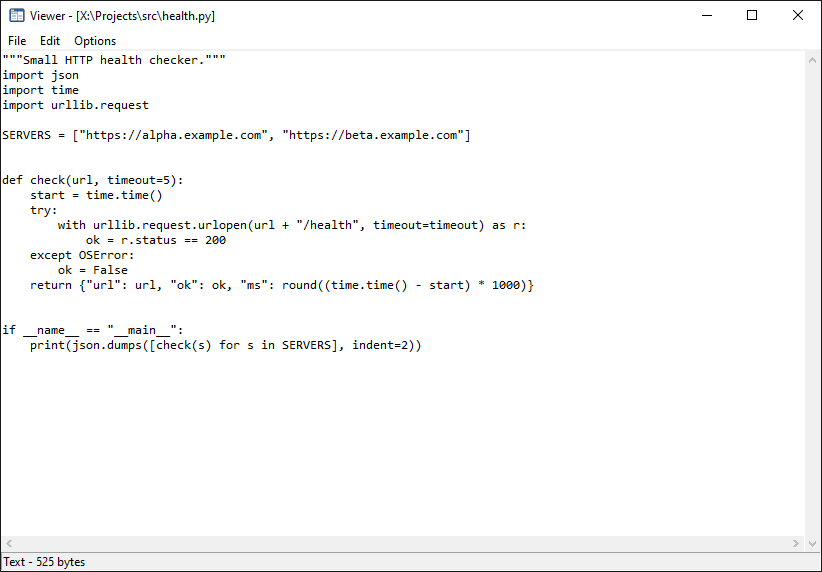
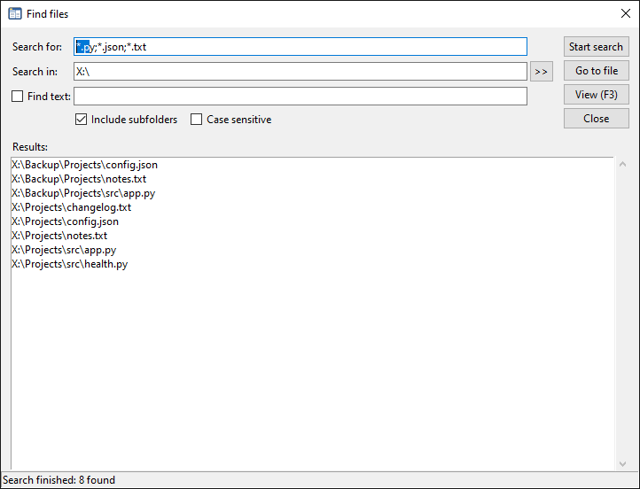
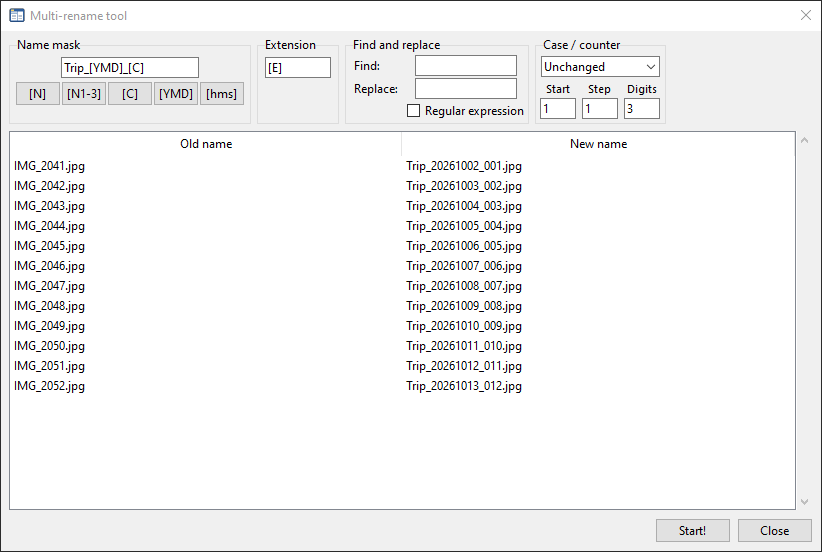
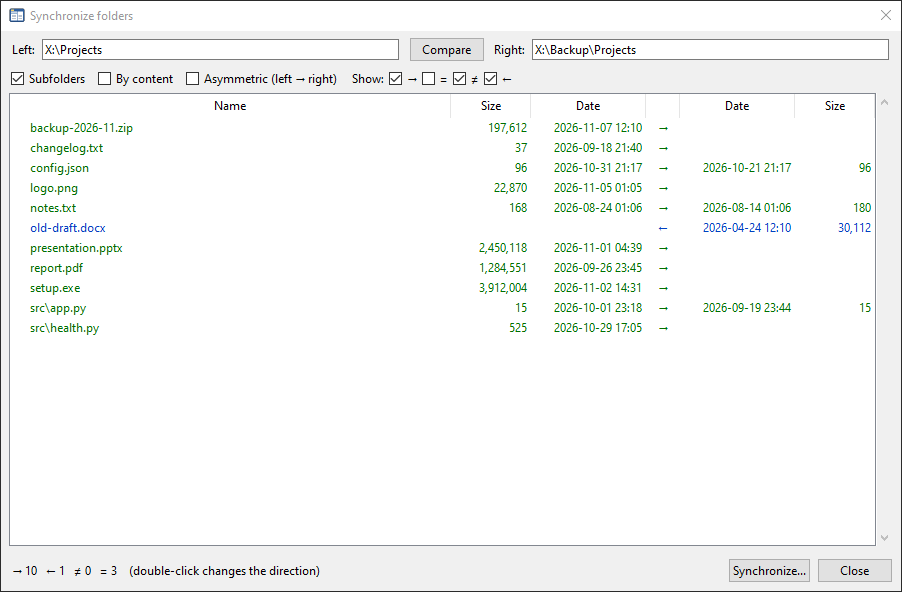
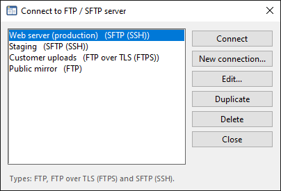
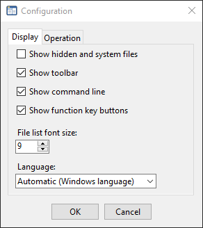

# 2 Commander

A keyboard-driven **dual-pane file manager** for Windows, written in Python with Tkinter.
Two file lists side by side, F-keys for every common operation, a command line always at hand —
plus ZIP archives, FTP/FTPS/SFTP servers and Python plugins, all browsed the same way as local
folders.



- **No installation** — clone and run `python main.py`.
- **One required dependency** ([Pillow](https://python-pillow.org/)); `paramiko` only if you need SFTP.
- **Local disk, ZIP archives and remote servers** share the same panels and the same F-keys:
  copy, move, rename, delete and edit work across all of them.
- **Responsive** — long operations run in the background with progress and cancel.
- **Extensible** — drop a `.py` file in the plugins folder to add commands or file viewers.
- **Multilingual** — English and Spanish included; adding a language is a single JSON file.

---

## Table of contents

- [Requirements](#requirements)
- [Installation](#installation)
- [Usage](#usage)
- [Features](#features)
- [Keyboard shortcuts](#keyboard-shortcuts)
- [Tools](#tools)
- [FTP, FTPS and SFTP](#ftp-ftps-and-sftp)
- [Plugins](#plugins)
- [Languages](#languages)
- [Configuration](#configuration)
- [Project structure](#project-structure)
- [Known limitations](#known-limitations)
- [Contributing](#contributing)
- [License](#license)

---

## Requirements

| | |
|---|---|
| Operating system | Windows 10 / 11 (see [Known limitations](#known-limitations) for other systems) |
| Python | 3.8 or later, with Tkinter (included in the official python.org installer) |
| Required | `pillow >= 9` |
| Optional | `paramiko` — only for SFTP connections |

## Installation

```bash
git clone https://github.com/<user>/2-commander.git
cd 2-commander
python -m venv .venv
.venv\Scripts\activate
pip install -r requirements.txt
pip install paramiko          # optional, for SFTP
```

## Usage

```bash
python main.py
```

### Screenshot mode

```bash
python main.py --screenshot shots/capture.png
```

Opens the window without stealing focus from whatever you are using, waits for it to finish
drawing, saves a PNG of the window and exits. Useful for documentation and for checking visual
changes. In this mode the user configuration is neither read nor saved.

### Command-line options

| Option | Description |
|---|---|
| `--lang CODE` | Interface language for this run only (`en`, `es`, …), without changing the saved setting |
| `--screenshot FILE.png` | Screenshot mode (see above) |

```bash
python main.py --lang en
python main.py --lang en --screenshot shots/english.png
```

## Features

### Panels
- Two equal-width panels, each with a drive bar, drive selector, volume label and free space.
- **Tabs** per panel (`Ctrl+T` / `Ctrl+W`). A **locked** tab never changes folder: navigating
  from it opens a new tab instead.
- **Brief** or **full** view (name, extension, size, date and attributes).
- Sort by name, extension, date, size or unsorted; click a column header to reverse the order.
- Filters by mask (`*.exe;*.bat`, …) and a toggle for hidden and system files (`Ctrl+H`).
- Per-tab folder history (back / forward, `Alt+↓` for the list) and **favorite directories**
  (`Ctrl+D`).
- The panel refreshes automatically when the folder contents change on disk.
- Marked files are shown in red; the status line shows the count and total size of the selection.

### Quick view (`Ctrl+Q`)
The opposite panel previews whatever is under the cursor: text, images (scaled to fit) or the
contents of a folder. Works for files on disk, inside ZIP archives and on servers.



### File operations
- Copy, move, rename, create folders and delete, with a progress window and a cancel button.
- Operations run in a background thread; the interface never freezes.
- Prompts when the target exists (overwrite, skip, overwrite all, skip all…).
- Delete to the **Recycle Bin** or permanently (`Shift+F8`).
- In-place rename (`Shift+F6`) and copy with a new name in the same folder (`Shift+F5`).
- File clipboard between panels and folders: `Ctrl+C`, `Ctrl+X`, `Ctrl+V`.
- `Space` calculates a folder's total size.
- Change attributes (read-only, hidden, system, archive) and open the Windows properties
  dialog (`Alt+Enter`).
- Copy the names of the marked files (with or without full path) to the clipboard.

### ZIP archives
`.zip`, `.jar` and `.cbz` files open with `Enter` and behave like folders — **read and write**:

- Browse subfolders, view (`F3`) and quick-view files inside the archive.
- `F5` / `F6` copy or move files **into** and **out of** the archive, including directly
  between an archive and an FTP/SFTP server.
- `F7` creates folders, `F8` deletes, `Shift+F6` renames files or whole folders.
- `F4` extracts a temporary copy, opens it in your editor and offers to save it back to the
  archive when you are done.
- Archives are rewritten through a temporary file that replaces the original only at the end,
  so an interrupted operation never leaves a corrupt archive.
- Compress the marked files into a new archive (`Alt+F5`) and extract one or more archives
  (`Alt+F9`).



### Command line
- Anything you type over the file list goes straight to the command line.
- `Enter` runs the command in the active panel's folder (in a new console window).
- `cd <path>` and `C:` change folder or drive inside the panel instead of running a program.
- `Ctrl+Enter` inserts the file name under the cursor; `Ctrl+P` inserts the current path.
- The last 30 commands are kept in a drop-down history.

### Windows integration
- Real Windows Shell icons for files, folders and drives, with Pillow-drawn icons as a fallback.
- Open a console (`cmd`) or Explorer in the current folder; Notepad and console buttons on the
  toolbar.
- Map and disconnect network drives with the standard Windows dialogs.
- Custom, editable **Start** menu for launching frequently used programs.

## Keyboard shortcuts

`F1` shows a summary inside the program.

### Basics

| Key | Action |
|---|---|
| `Tab` | Switch panel |
| `Enter` | Open folder or archive / run file / run the command line |
| `Backspace` | Parent folder (or delete a character in the command line) |
| `Insert` / `Space` | Mark file (`Space` also calculates folder size) |
| `Home` / `End` | First / last item |
| `Esc` | Clear the command line |

### Function keys

| Key | Action | With `Shift` | With `Alt` |
|---|---|---|---|
| `F1` | Help | | Choose drive (left panel) |
| `F2` | Refresh | Compare directories | Choose drive (right panel) |
| `F3` | View | | |
| `F4` | Edit | New text file | Exit |
| `F5` | Copy | Copy in the same folder | Compress |
| `F6` | Move / rename | Rename in place | |
| `F7` | New folder | | Find files |
| `F8` / `Del` | Delete | Delete permanently | |
| `F9` | | | Extract |

### With `Ctrl`

| Key | Action |
|---|---|
| `Ctrl+F1` / `Ctrl+F2` | Brief / full view |
| `Ctrl+F3` … `Ctrl+F7` | Sort by name, extension, date, size, unsorted |
| `Ctrl+Q` | Quick view |
| `Ctrl+U` | Swap panels |
| `Ctrl+M` | Multi-rename |
| `Ctrl+D` | Favorite directories |
| `Ctrl+H` | Show / hide hidden files |
| `Ctrl+R` | Refresh |
| `Ctrl+T` / `Ctrl+W` | New tab / close tab |
| `Ctrl+Tab` / `Ctrl+Shift+Tab` | Next / previous tab |
| `Ctrl+←` / `Ctrl+→` | Open the selected folder in the left / right panel |
| `Ctrl+\` | Go to the drive root |
| `Ctrl+PgUp` | Parent folder |
| `Ctrl+A` | Select all |
| `Ctrl+C` / `Ctrl+X` / `Ctrl+V` | Copy / cut / paste files |
| `Ctrl+Enter` | File name to the command line |
| `Ctrl+P` | Current path to the command line |
| `Ctrl+F` | Connect to an FTP / SFTP server |
| `Ctrl+N` | Quick connect by URL |
| `Ctrl+Shift+F` | Disconnect from the server |
| `Ctrl+Shift+H` | Checksums (example plugin) |

### Selection and navigation

| Key | Action |
|---|---|
| `Num +` / `Num -` | Select / deselect by mask |
| `Num *` | Invert selection |
| `Ctrl+Num +` / `Ctrl+Num -` | Select / deselect all |
| `Alt+←` / `Alt+→` | History back / forward |
| `Alt+↓` | History menu |
| `Alt+Enter` | Properties |

With the mouse: double-click opens, `Ctrl+click` marks an item, `Shift+click` marks a range,
right-click opens the context menu.

## Tools

### Viewer (`F3`)
Shows files in **text**, **hex** or **image** mode (up to 8 MB). The encoding is detected
automatically or can be set to UTF-8, ANSI (Windows-1252) or DOS (CP850). Plugins can register
custom viewers for specific extensions.

Keys: `1` text, `3` hex, `4` image, `W` word wrap, `F7` / `Ctrl+F` find, `F3` find next,
`Esc` or `Q` close.



### Find files (`Alt+F7`)
Search by mask (`*.txt;*.log`), optionally for text contained in the files, in subfolders and
case-sensitive. The search runs in the background; results can be viewed (`F3`) or opened in the
panel with the cursor on the file.



### Multi-rename (`Ctrl+M`)
Renames all marked files with a mask, showing a live preview of the new names.

| Placeholder | Meaning |
|---|---|
| `[N]` | Original name without extension |
| `[N1-3]` | Characters 1 to 3 of the name (`[N5]` a single character, `[N5-]` from 5 to the end) |
| `[E]` | Original extension |
| `[C]` | Counter (configurable start, step and number of digits) |
| `[YMD]` | Modification date, `YYYYMMDD` |
| `[hms]` | Modification time, `HHMMSS` |

Also: find and replace (plain text or regular expression) and upper/lower case conversion.
If two files would end up with the same name, nothing is renamed.



### Compare directories (`Shift+F2`)
Marks the files in each panel that are missing on the other side or are newer.

### Synchronize folders (*Commands* › *Synchronize folders*)
Compares two folders (with or without subfolders, by date and size or by content) and lists what
would be copied in each direction: `→`, `←`, `=` identical, `≠` different with no clear
direction. Double-click a row to change its direction. **Asymmetric** mode only copies from left
to right.



### Compare by content (*File* › *Compare by content*)
Compares two files byte by byte (the file under the cursor in each panel, or two marked files)
and reports the first difference.

## FTP, FTPS and SFTP

A panel can show a remote server just like a local folder: browse, view, quick-view, edit,
create folders, rename and delete, and copy or move files in both directions between the
server, the local disk and ZIP archives.



- **Saved connections** (`Ctrl+F`, or *Network* › *Connect to FTP / SFTP server*):
  create, edit, duplicate and delete connections. Each one stores the protocol, host, port,
  user, initial remote folder, passive mode, file-name encoding and, for SFTP, a private key file.
- **Quick connect** (`Ctrl+N`): type a URL such as `ftp://user@host/folder` or
  `sftp://user@host:22/`.
- **Passwords** are only stored if you ask for it, encrypted with Windows DPAPI so that only your
  Windows user account can decrypt them. Otherwise you are asked when connecting.
- **SFTP host keys**: the first connection to a server shows its SHA-256 fingerprint and asks
  whether to trust it; trusted keys are saved to `known_hosts` in the configuration folder.
  SSH agent and default keys are used automatically when no password or key file is set.
- **Robust connections**: idle FTP sessions are checked and reconnected transparently; directory
  listings use `MLSD` and fall back to `LIST` (Unix and Windows/IIS formats).
- Moving files within the same server is done with a server-side rename (no download/upload).
- `F4` on a remote file downloads a temporary copy and uploads it back when you save.
- `Ctrl+Shift+F` disconnects; any tab that was showing the server goes back to its last local
  folder.

Supported protocols: **FTP**, **FTP over TLS (FTPS, explicit)** and **SFTP (SSH)**. SFTP requires
`paramiko`; if it is missing, the program shows the exact `pip install` command to run.

## Plugins

Plugins are plain Python files that add commands to the menu and custom viewers to `F3`.
They are loaded from two folders:

| Folder | Contents |
|---|---|
| `plugins/` next to `main.py` | Example plugins shipped with the program |
| `%APPDATA%\2Commander\plugins\` | Your own plugins (a file with the same name replaces the example) |

Manage them from *Configuration* › *Plugins*: enable or
disable each one, see load errors, open your plugins folder and reload without restarting.
Plugin commands appear under *Commands* › *Plugins* and can have their own keyboard shortcut.

### Included examples

| Plugin | What it does |
|---|---|
| `sumas_de_verificacion.py` | MD5, SHA-1 and SHA-256 of the marked files, shown and copied to the clipboard (`Ctrl+Shift+H`) |
| `visor_json.py` | `F3` on a `.json` file shows it pretty-printed and indented |

### Writing a plugin

Each file defines a `register(api)` function. The optional `NAME` and `DESCRIPTION` are shown in
the plugin manager (the Spanish `NOMBRE` / `DESCRIPCION` also work). To show them in the user's
language, add `NAMES` / `DESCRIPTIONS` dictionaries keyed by language code, and use
`api.language()` to pick the text of your commands and messages:

```python
NAME = "Count marked"
NAMES = {"es": "Contar marcados"}
DESCRIPTION = "Shows how many files are marked."
DESCRIPTIONS = {"es": "Muestra cuántos archivos hay marcados."}

TEXTS = {
    "en": ("Count marked files", "{n} file(s) marked"),
    "es": ("Contar archivos marcados", "{n} archivo(s) marcado(s)"),
}

def register(api):
    label, msg = TEXTS.get(api.language(), TEXTS["en"])
    api.add_command(
        label,
        lambda: api.message(msg.format(n=len(api.selected_paths()))),
        "Ctrl+Shift+K",
    )
```

The `api` object provides:

| Method | Purpose |
|---|---|
| `add_command(label, callback, shortcut=None)` | Add a menu command, optionally with a shortcut such as `"Ctrl+Shift+H"` |
| `add_viewer(extensions, callback)` | `callback(name, data_bytes)` returns the text to show in the viewer, or `None` to fall back to the normal viewer; `"*"` matches every extension |
| `current_dir()` / `other_dir()` | Folder of the active / other panel (`None` if it is not on disk) |
| `selected_paths()` / `cursor_path()` | Marked files (or the one under the cursor) / file under the cursor |
| `refresh()` / `go_to(folder)` | Reload both panels / navigate the active panel |
| `show_text(title, text)` | Open text in the viewer |
| `message(text)` / `ask(prompt, initial)` / `confirm(text)` | Simple dialogs |
| `copy_to_clipboard(text)` / `status(text)` | Clipboard / status bar |
| `language()` | Active interface language code (`"en"`, `"es"`, …) |

Errors raised by a plugin are caught and reported; they never crash the program.

## Languages

The interface is available in **English** and **Spanish**. Choose the language in
*Configuration* › *Options* › *Display* › *Language*; the program offers to restart to apply it.
The default, **Automatic**, follows the Windows display language and falls back to English when
that language is not available. `--lang CODE` overrides the setting for a single run.



Dates and numbers in the file lists follow the language too (`2026-11-10 12:10` and `1,234,567`
in English; `10/11/2026 12:10` and `1.234.567` in Spanish).

### Adding a translation

The source texts in the code are Spanish, marked with `_("...")`. Each additional language is one
file, `fm/locales/<code>.json`, mapping every Spanish text to its translation:

```json
{
 "_name": "Français",
 "Copiar": "Copier",
 "Copiar {n} elemento(s) a:": "Copier {n} élément(s) vers :",
 "menú|Ver": "Afficher"
}
```

1. Copy `fm/locales/en.json` to `fm/locales/<code>.json` (two-letter ISO code, e.g. `fr`) and set
   `_name` to the language's own name — it appears as-is in the language list.
2. Translate the values. Keep `{placeholders}` and `\n` line breaks; keys of the form
   `context|text` are the same text used in a different place (e.g. `menú|Ver` is the *Show*
   menu, while `Ver` is the *View* command).
3. Check it: `python tools/check_translations.py` lists missing entries, `{placeholder}`
   mismatches and unused entries for every locale file.

Untranslated entries fall back to the Spanish text, so a partial translation still works.

## Configuration

From *Configuration* › *Options*:

- **Display:** show hidden and system files; show the toolbar, the command line and the F-key
  buttons; font size of the file lists; interface language.
- **Operation:** delete to the Recycle Bin or permanently; ask for confirmation; editor used by
  `F4` (default `notepad.exe`); save window position and folders on exit.

Everything is stored in:

```
%APPDATA%\2Commander\
├── config.json     settings and language, window size, folders and tabs, sort order,
│                   favorites, command history, Start menu, saved connections, disabled plugins
├── known_hosts     trusted SFTP server keys
└── plugins\        your own plugins
```

To restore the defaults, delete `config.json`. If you used the program under its previous name,
the settings in `%APPDATA%\ComandanteDoble\config.json` are read automatically the first time and
saved to the new folder on exit.

## Project structure

```
.
├── main.py              Entry point and --screenshot mode
├── requirements.txt
├── docs/screenshots/    Images used in this README
├── plugins/             Example plugins
├── tools/
│   └── check_translations.py   Checks the locale files against the texts in the code
└── fm/
    ├── app.py           Main window: menus, toolbar, keys, command line, high-level commands
    ├── panel.py         A single panel: drives, tabs, path, list, quick view and status line
    ├── vfs.py           Locations (disk, ZIP, server), listings, attributes, Recycle Bin, formatting
    ├── transfer.py      Copy / move / delete / rename between disk, ZIP archives and servers
    ├── remote.py        FTP, FTPS and SFTP clients, connection registry, DPAPI password storage
    ├── connect.py       Connection manager, connection editor and quick connect dialogs
    ├── dialogs.py       Dialogs, progress window, viewer, find files, multi-rename, options
    ├── sync.py          Folder synchronization
    ├── plugins.py       Plugin loader and plugin API
    ├── icons.py         System icons (Shell API) with Pillow-drawn fallbacks
    ├── i18n.py          Translation functions, language detection, number and date formats
    └── locales/
        └── en.json      English translation (Spanish is the source language)
```

## Known limitations

- Built for **Windows**. Icons, attributes, the Recycle Bin, drive lists, network drives and
  password encryption use the Windows API. On Linux/macOS the program may start with drawn icons,
  but those features are unavailable or untested.
- Only ZIP-based archives are supported (`.zip`, `.jar`, `.cbz`); no RAR, 7z or TAR.
- Synchronize folders, multi-rename, change attributes, compare by content and compress work on
  local folders only (not inside archives or on servers).
- FTPS uses explicit TLS only; implicit FTPS (port 990) is not supported.

## Contributing

1. Fork the repository and create a branch: `git checkout -b my-change`.
2. Test your change with `python main.py`; for visual changes, generate a screenshot with
   `--screenshot`.
3. If you add or change user-visible text, wrap it in `_("...")` (Spanish source text, with
   `.format()` for values), add the English entry to `fm/locales/en.json` and run
   `python tools/check_translations.py`.
4. Open a pull request describing what changes and why.

Bug reports are welcome in Issues; please include your Windows and Python versions.

## License

Distributed under the MIT License. See [LICENSE](LICENSE).
